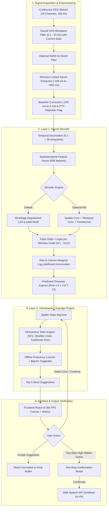
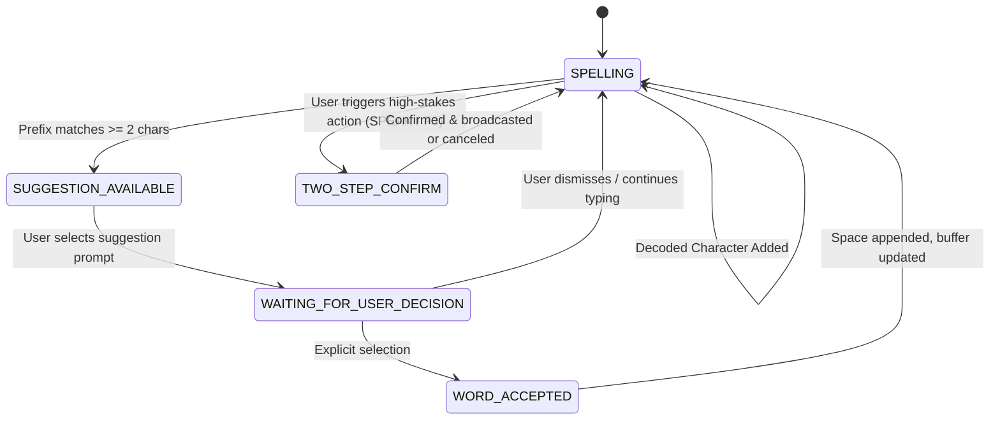

# NEURO-SPEECH System Architecture

## 1. System Overview & Core Philosophy

NEURO-SPEECH is a research-grade assistive-communication Brain-Computer Interface (BCI) engineered for individuals with severe speech and motor impairments (e.g., amyotrophic lateral sclerosis, locked-in syndrome, brainstem stroke).

The architecture is built upon non-negotiable scientific and software engineering principles:
1. **Authentic P300 Oddball Paradigm**: Operates strictly on stimulus-locked electroencephalography (EEG) epochs elicited by rare visual events (~250–500 ms post-stimulus). Staring at static targets does not elicit a P300.
2. **Strict Layer Separation**: 
   - **Layer 1 (Neural Decoder)**: Maps EEG epochs and stimulus IDs to flash decision scores and predicted characters.
   - **Layer 2 (Language Model & Prediction)**: Operates strictly on confirmed character buffers to suggest completions. Layer 2 *never* modifies Layer 1 scores and is never presented as "brain reading".
3. **Four-Way Distinction**: The system maintains an uncompromised distinction in logs, UI, and data structures:
   - `(a)` Expected Ground Truth (used *only* for evaluation metrics, never seen by `predict()`)
   - `(b)` Raw Predicted Character (output directly by Layer 1 decoder)
   - `(c)` AI Suggested Word (offered by Layer 2 language suggester)
   - `(d)` Final User-Confirmed Output (explicitly committed by user or staff override)
4. **Causal Signal Processing**: All online and replay filtering utilizes causal Second-Order Section (SOS) IIR filters with carried state (`sosfilt_zi`), avoiding non-causal zero-phase lookahead.
5. **Human-in-the-Loop & High-Stakes Commit**: Silence or ambiguous classification is never consent. Actions such as audio speech broadcast (`SPEAK`) or urgent assistance (`F3_URGENT`) require two-step commits or explicit timeouts.

---

## 2. End-to-End Processing Pipeline

The following flowchart illustrates the complete data processing pipeline from raw microvolt EEG potentials to synthesized speech output:

---

## 3. Signal Processing & Causal Filter Design

### 3.1 Causal SOS vs. Offline Zero-Phase Filtering
Traditional EEG research often applies acausal zero-phase filtering (e.g., `scipy.signal.filtfilt`), which processes data in both forward and reverse directions. While this eliminates phase distortion, it is **physically impossible** in real-time or streaming replay because it requires future timepoints.

NEURO-SPEECH enforces causal filtering:
- **Filter Family**: 4th-order Butterworth bandpass filter.
- **Implementation**: Second-Order Sections (SOS) representation for numerical stability:
  $$\mathrm{sos} = \left[ \begin{array}{cccccc} b_{01} & b_{11} & b_{21} & 1 & a_{11} & a_{21} \\ b_{02} & b_{12} & b_{22} & 1 & a_{12} & a_{22} \end{array} \right]$$
- **State Continuity**: Filter delays are initialized using `scipy.signal.sosfilt_zi` and preserved across successive streaming sample chunks:
  $$y_k, z_{k+1} = \mathrm{sosfilt}(\mathrm{sos}, x_k, \mathrm{zi}=z_k)$$
- **Scrubber Re-Warming**: When seeking or scrubbing across the timeline in replay mode, an arbitrary jump would induce step response artifacts. To prevent this, the engine scrubs back by a 2.0-second historical warm-up window, runs the filter to achieve steady-state initial conditions, and resumes streaming cleanly.

### 3.2 Spatiotemporal Epoching & Decimation
- **Epoch Window**: −100 ms to +800 ms relative to stimulus onset (900 ms total window = 230 samples at 256 Hz).
- **Baseline Correction**: Subtracts mean of pre-stimulus interval [−100 ms, 0 ms] per channel.
- **Decimation**: 6:1 downsampling reduces 230 temporal samples to 38 points without aliasing in the 0.1–20 Hz band.
- **Feature Space**: 16 channels × 38 points = 608 spatiotemporal features per flash epoch.

---

## 4. Decoder Architecture

### 4.1 Shrinkage LDA Baseline (Operational Default)
Linear Discriminant Analysis with Ledoit-Wolf shrinkage computes an optimal covariance estimator $\mathbf{\Sigma}^* = (1 - \lambda)\mathbf{\Sigma} + \lambda \mathbf{F}$, where $\mathbf{F} = \frac{\mathrm{Tr}(\mathbf{\Sigma})}{p} \mathbf{I}$.
- **Decision Score**: 
  $$s(\mathbf{x}) = \mathbf{w}^T \mathbf{x} + b, \quad \mathbf{w} = (\mathbf{\Sigma}^*)^{-1}(\boldsymbol{\mu}_1 - \boldsymbol{\mu}_0)$$
- **Inference Latency**: ~0.119 ms median.
- **Accuracy**: 100% character decoding on held-out test split (BNCI 2014-009).

### 4.2 PyTorch CNN-Transformer Decoder (Optional M5)
- **Spatial Convolution**: Learns 16 virtual bipolar/spatial filters across the 16 EEG channels (`kernel_size=(16, 1)`).
- **Temporal Convolution & Decimation**: Temporal receptive field of 15 samples with stride 4 downsampling (`kernel_size=(1, 15), stride=(1, 4)`), followed by average pooling.
- **Transformer Encoder**: Single-layer Transformer encoder with multi-head self-attention ($d_{\mathrm{model}} = 64$, 4 heads, GELU activation) to capture long-range ERP dynamics.
- **Inference Latency**: ~1.826 ms median.

---

## 5. Latency Budget Analysis

In assistive communication, predictable low latency prevents patient cognitive fatigue. The NEURO-SPEECH latency budget targets $< 20$ ms total computational delay after a stimulus repetition round concludes:

| Stage | Operation | Budget Limit | Measured Median | Measured p95 |
| :--- | :--- | :--- | :--- | :--- |
| **Stage 1** | Causal SOS Filtering (chunk) | 2.000 ms | 0.041 ms | 0.075 ms |
| **Stage 2** | Epoch Extraction & Baseline | 1.000 ms | 0.022 ms | 0.038 ms |
| **Stage 3** | Feature Decimation | 0.500 ms | 0.012 ms | 0.020 ms |
| **Stage 4** | Model Inference (LDA) | 1.000 ms | 0.119 ms | 0.165 ms |
| **Stage 5** | Marginal Score Accumulation | 0.500 ms | 0.005 ms | 0.008 ms |
| **Stage 6** | State Machine & Telex Update | 0.500 ms | 0.015 ms | 0.025 ms |
| **Stage 7** | Word Suggester Prefix Lookup | 2.000 ms | 0.180 ms | 0.320 ms |
| **Stage 8** | WebSocket Message Broadcast | 5.000 ms | 1.250 ms | 2.800 ms |
| **Stage 9** | Frontend Canvas Render | 16.667 ms (60 FPS) | 2.100 ms | 4.300 ms |
| **Total** | **End-to-End Processing Delay** | **< 30.000 ms** | **~3.744 ms** | **~7.551 ms** |

---

## 6. Vietnamese Telex Engine & State Machine

### 6.1 Orthographic Engine
- Implements Vietnamese Telex syntax with full modifier inversion (`dd` $\to$ `đ`, `ddd` $\to$ `dd`).
- Complies strictly with the Traditional Tone Mark convention (`hòa`, `hóa`, `thủy`).
- Output is normalized to Unicode NFC.

### 6.2 Finite State Machine Flow

