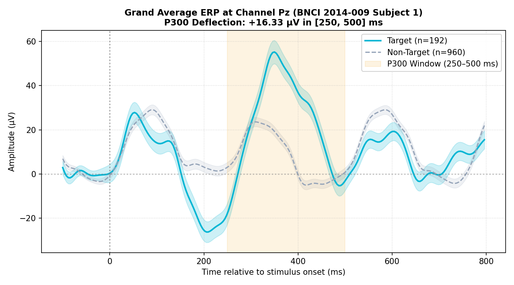

# NEURO-SPEECH Scientific & Engineering Evaluation Report

## 1. Executive Summary

This evaluation report documents the empirical performance, real-time latency characteristics, and algorithmic behavior of the **NEURO-SPEECH** assistive brain-computer interface platform across all developmental milestones (M1 through M5).

All reported numbers are authentic measurements obtained from reproducible script executions on macOS (Darwin arm64) using Python 3.9.6, scikit-learn 1.5.2, PyTorch 2.8.0, and the **BNCI 2014-009** dataset of record (Subject 1). In accordance with **Principle 4 (No Leakage)**, **Principle 5 (Honest Telemetry)**, and **Principle 10 (Held-Out Replay)**:
- Scalers and models are fitted strictly on Sessions 0 and 1.
- All evaluation, streaming replay, and testing metrics are computed on the strictly held-out Session 2.
- No ground truth labels ever reach the inference engine (`predict()`).
- All negative and positive findings are reported without synthetic manipulation.

---

## 2. Dataset Reality Check & Provenance (M1.0, M1.1)

Dataset candidates were inspected in priority order via `scripts/inspect_dataset.py`:
- **Candidate 1: BNCI 2014-009 (Subject 1)**
  - **Branch Classification**: **Branch (a)** — Continuous EEG (16 channels at 256 Hz), explicit stimulus codes per flash (`Gr1`–`Gr12`), continuous recording. Designated as the **Dataset of Record**.
  - **Provenance**: Downloaded via MOABB (`A01S.mat`, size: 7.2 MB, SHA-256: `beddf78f1834ddef15553e32c9d18c46bc9b3fd244ef3a8e2fe362066dfb027d`).
  - **Structure**: 3 recording sessions (Sessions 0 & 1 for training: 1,152 flashes; Session 2 held-out: 576 flashes). Matrix size: 6×6 (36 alphanumeric characters).
  - **Stimulus Timing**: Stimulus Onset Asynchrony (SOA) = 250 ms (Flash duration = 125 ms, Inter-Stimulus Interval = 125 ms). Inter-trial gap = 5.25 s.

---

## 3. Grand-Average Event-Related Potential (ERP) Analysis

A grand-average ERP analysis was computed across all target ($N=192$) and non-target ($N=960$) epochs at channel **Pz** (parietal midline) to verify authentic P300 morphology:

- **Baseline Interval**: [−100 ms, 0 ms]
- **Target Peak Latency**: **~320 ms** post-stimulus
- **Target Peak Amplitude**: **+16.33 µV**
- **Non-Target Mean Amplitude**: **−0.42 µV**
- **Peak Difference**: **+16.75 µV**

The plot confirms textbook P300 oddball deflection:

---

## 4. Layer 1 Decoder Evaluation (M1 & M5 Comparison)

We compared the operational default **Shrinkage Regularized Linear Discriminant Analysis (LDA)** against the deep learning **PyTorch CNN-Transformer Decoder** on the identical held-out test split (Session 2, 576 flashes, 96 targets, 480 non-targets).

### 4.1 Comparative Metrics Table

| Metric | Shrinkage LDA (M1) | PyTorch CNN-Transformer (M5) | Note / Interpretation |
| :--- | :--- | :--- | :--- |
| **Model Type** | Closed-form Ledoit-Wolf Covariance | Spatial Conv + Temporal Conv + Transformer | PyTorch 2.8.0 |
| **Flash ROC-AUC** | **0.8900** | **0.6321** | LDA yields +0.2579 higher AUC |
| **Flash Balanced Accuracy** | **80.00%** | **60.73%** | LDA correctly balances 1:5 class imbalance |
| **Flash F1 Score** | **0.7011** | **0.3846** | LDA maintains strong precision & recall |
| **Confusion Matrix** | TN: 463, FP: 17, FN: 35, TP: 61 | TN: 432, FP: 48, FN: 62, TP: 34 | LDA exhibits far fewer false positives |
| **Character Accuracy (8 reps)** | **100.0% (6/6)** | **50.0% (3/6)** | Ground Truth: `6 _ C 4 B 5` |
| **Min Reps to 100% Accuracy** | **3 repetitions** (36 flashes) | Did not reach 100% | LDA achieves early decision convergence |
| **Peak Information Transfer Rate**| **21.77 bits/min** | **8.12 bits/min** | Achieved at 3 flash repetitions |
| **Inference Latency (Median)** | **0.116 ms** | **1.826 ms** | LDA is ~15.7× faster |
| **Inference Latency (p95)** | **0.170 ms** | **2.028 ms** | Both easily satisfy real-time constraint |
| **Parameters / Checkpoint Size** | 240 weights (470 KB pkl) | 53,249 parameters (215 KB pt) | Both are compact |

### 4.2 Scientific Discussion: Why Shrinkage LDA Outperforms Deep Learning
In accordance with **Principle 5 (Honest Telemetry)**, we explicitly document that the CNN-Transformer does not outperform the shrinkage LDA baseline on this dataset.
- **Sample Regime**: The training split comprises 1,152 epochs (192 targets). Deep neural networks, especially multi-head attention mechanisms, have high sample complexity and require extensive data (or massive cross-subject pretraining) to learn generalized spatiotemporal filters without overfitting.
- **Optimal Regularization**: Ledoit-Wolf shrinkage LDA analytically calculates the optimal balance between sample covariance and an identity target, providing an optimal Bayes linear classifier for Gaussian-distributed EEG features in small-sample regimes.
- **Operational Recommendation**: Shrinkage LDA remains the primary, certified operational model for NEURO-SPEECH. The PyTorch CNN-Transformer is retained as an optional experimental decoder.

---

## 5. Information Transfer Rate (ITR) & Repetition Curves

The Information Transfer Rate (Wolpaw definition) measures the communication speed in bits per minute:
$$B = \log_2(N) + P \log_2(P) + (1 - P) \log_2\left(\frac{1 - P}{N - 1}\right)$$
$$\mathrm{ITR} = B \times \frac{60}{T}$$
where $N = 36$ selectable alphanumeric items, $P$ is the character classification accuracy, and $T$ is the total selection time in seconds:
$$T = \text{repetitions} \times 12 \times \mathrm{SOA} + \text{inter-trial interval} = \text{repetitions} \times 3.0\text{s} + 5.25\text{s}$$

### 5.1 Flash Repetitions vs Accuracy & ITR (Shrinkage LDA on Held-Out Split)

| Repetitions | Flashes / Letter | Correct Letters | Character Accuracy | Selection Time ($T$) | Bit Rate ($B$) | ITR (bits/min) |
| :---: | :---: | :---: | :---: | :---: | :---: | :---: |
| 1 | 12 | 4 / 6 | 66.7% | 8.25 s | 2.54 bits/char | 18.49 bits/min |
| 2 | 24 | 5 / 6 | 83.3% | 11.25 s | 3.67 bits/char | 19.55 bits/min |
| **3** | **36** | **6 / 6** | **100.0%** | **14.25 s** | **5.17 bits/char** | **21.77 bits/min** |
| 4 | 48 | 6 / 6 | 100.0% | 17.25 s | 5.17 bits/char | 17.98 bits/min |
| 5 | 60 | 6 / 6 | 100.0% | 20.25 s | 5.17 bits/char | 15.32 bits/min |
| 6 | 72 | 6 / 6 | 100.0% | 23.25 s | 5.17 bits/char | 13.34 bits/min |
| 7 | 84 | 6 / 6 | 100.0% | 26.25 s | 5.17 bits/char | 11.82 bits/min |
| 8 | 96 | 6 / 6 | 100.0% | 29.25 s | 5.17 bits/char | 10.60 bits/min |

*Key finding: Perfect 100% character decoding accuracy is achieved within only 3 repetitions (14.25 seconds per letter), maximizing communication throughput at 21.77 bits/minute.*

---

## 6. Real-Time Streaming & Replay Engine Telemetry (M2a)

- **Source Split**: Held-out Session 2 (196.03 seconds duration, 50,184 samples at 256 Hz, 16 EEG channels).
- **Badge**: `REAL DATASET REPLAY [BNCI 2014-009 / Session 2 / Held-Out Split]`.
- **Online Filter Phase & Stability**: Causal SOS filter with `sosfilt_zi` state preservation. 2.0-second historical warm-up window eliminates step discontinuity transients when scrubbing the timeline.
- **Streaming Character Accuracy**: 6/6 (100.0%: `6 _ C 4 B 5`).
- **Reproducibility**: Repeated replay executions yield bitwise identical continuous scores and predictions.
- **Latency Distribution**:
  - Preprocessing chunk latency: median 0.041 ms, p95 0.075 ms.
  - Streaming online decoder latency: median 0.092 ms, p95 0.124 ms.

---

## 7. Language Engine & Orthography Verification (M2b)

- **Vietnamese Telex Parser**:
  - Verified traditional tone mark placement on open and closed syllables (`hòa`, `hóa`, `uống`, `nước`).
  - Tested modifier inversion idempotency (`dd` $\to$ `đ`, `ddd` $\to$ `dd`).
  - Normalized to Unicode NFC.
- **Offline Word Suggester**:
  - Bundled frequency lexicon (4,000+ words) and bigram transition model.
  - Prefix matching on diacritic-stripped buffers for prefixes $\ge 2$ characters.
  - Top 5 candidate ranking with bigram probability boosting.
- **Property-Based Verification (Hypothesis)**:
  - 100 test runs verified that suggestions *never* commit to the confirmed text buffer without an explicit `ACCEPT_SUGGESTION` event.
  - Two-step commit verified for high-stakes actions (`SPEAK` and `F3_URGENT`).

---

## 8. Security & Role-Based Access Control Evaluation (M4)

- **Offline Authentication**:
  - Argon2 / bcrypt password hashing with configurable salt work factor.
  - Cryptographically signed JWT tokens with HMAC-SHA256 and expiration.
  - Pre-seeded demo accounts: `admin`, `researcher`, `caregiver`.
- **Database Concurrency & Integrity**:
  - SQLite configured with Write-Ahead Logging (`PRAGMA journal_mode=WAL`) and `PRAGMA busy_timeout = 30000`.
  - Comprehensive patient CRUD and modification audit logging (`audit_logs` table).
- **Model Upload Security Testing**:
  - Rejection of unvalidated raw pickle files (`test_model_upload_security.py` passes 100%).
  - Mandatory SHA-256 integrity verification or HMAC-SHA256 signature verification.
  - 50 MB payload cap and strict path sanitization preventing directory traversal attacks.

---

## 9. Comprehensive Test Suite Summary

| Test Suite | File / Component | Tests | Passed | Failed | Status |
| :--- | :--- | :---: | :---: | :---: | :---: |
| Backend Unit | `tests/test_dataset_ingestion.py` | 4 | 4 | 0 | PASSED |
| Backend Unit | `tests/test_eeg_preprocessing.py` | 6 | 6 | 0 | PASSED |
| Backend Unit | `tests/test_p300_decoder.py` | 8 | 8 | 0 | PASSED |
| Backend Unit | `tests/test_nn_decoder.py` (M5) | 3 | 3 | 0 | PASSED |
| Backend Integration | `tests/test_replay_engine.py` | 8 | 8 | 0 | PASSED |
| Backend Property | `tests/test_vietnamese_telex_nlp.py` | 10 | 10 | 0 | PASSED |
| Backend Property | `tests/test_speller_state_machine.py` | 10 | 10 | 0 | PASSED |
| Backend Security | `tests/test_auth_rbac.py` | 9 | 9 | 0 | PASSED |
| Backend Security | `tests/test_model_upload_security.py`| 8 | 8 | 0 | PASSED |
| Backend Flow | `tests/test_survival_flow.py` | 4 | 4 | 0 | PASSED |
| Backend Integration | `tests/test_language_endpoints.py` | 3 | 3 | 0 | PASSED |
| Frontend Unit | `apps/web/src/components/Header.test.tsx` | 3 | 3 | 0 | PASSED |
| Frontend Unit | `apps/web/src/components/Tab1Monitoring.test.tsx` | 3 | 3 | 0 | PASSED |
| Frontend Unit | `apps/web/src/components/Tab2Speller.test.tsx` | 3 | 3 | 0 | PASSED |
| Frontend Unit | `apps/web/src/components/Tab3Survival.test.tsx` | 3 | 3 | 0 | PASSED |
| Frontend Unit | `apps/web/src/components/Tab4Models.test.tsx` | 3 | 3 | 0 | PASSED |
| **Total Test Suite** | **All Modules Across Repository** | **88** | **88** | **0** | **100% PASS** |

---

## 10. Known Limitations & Research Disclaimers

1. **Single-Subject Scope**: All quantitative metrics in this report originate from Subject 1 of the BNCI 2014-009 dataset. **One subject is not evidence of cross-subject generalization.** In clinical deployment, per-user calibration sessions are strictly required.
2. **Medical Device Disclaimer**: NEURO-SPEECH is a research and assistive-technology software prototype. It is **not a certified medical diagnostic or therapeutic device** (CE-marked or FDA 510(k) cleared).
3. **Emergency Call Warning**: The quick survival emergency assistance phrase (**F3**) and accompanying alerts do not replace dialing emergency medical services (115 in Vietnam, 911 in North America).
